# 海嘯模擬器：總體改版實作計畫書（四合一無衝突終極整合版）

> [!IMPORTANT]
> **文件說明（供 AI 代理直接執行實作）**
> 本計畫書已將以下四大改版完整整併，並消除所有新舊設計衝突：
> 1. **道具實體化、船隻設備、每週漁會捐款雙軌稱號、永久等級 (`Lv.X`) 與船隊組隊系統**
> 2. **移除扳手 (`wrench`) 與自動抽水龍骨 (`mod_hull`) ＋ 新增外海「海上修船屋（海上商店）」**
> 3. **右下角「大港灣島（Haven）」遠洋深水大港、批發魚市 (`+15%`)、遠洋船塢分店、海神祈福祭壇與山城夜景升級**
> 4. **三階船隻（小舢舨／近海漁船／遠洋大漁船）3D 外觀徹底分家與功能玩法差異化**

---

## 一、 設計衝突修正與全地圖規則統一總表

實作時請嚴格遵循以下**統一後的全局規則**，舊版草案中與此表抵觸之處一律以此表為準：

| 項目 | 統一後定案規則（無衝突版本） |
| :--- | :--- |
| **刪除道具** | 1. **徹底刪除「扳手 (`wrench`)」**：從所有商店、背包 (`kit.wrench`)、手持模型 (`handWrench`) 與甲板左鍵敲破洞機制中移除。<br/>2. **徹底刪除「自動抽水龍骨 (`mod_hull`)」**：從 `BOAT_MODS`、所有商店工作台、船體減傷與平板改裝頁移除（僅在 `server/room.js` 的 `cleanTabState` 保留 `hull` 欄位以相容既有資安單元測試）。 |
| **加油規則** | **全地圖統一使用「手提油桶 (`fuel`)」**：移除大港灣島原草案的「西翼直接加油柱」。母港漁具行、外海海上修船屋、大港灣島補給所皆販售手提油桶（`$80`，買了直接拿在手上走到船尾倒油）。 |
| **修船規則** | **改為「船塢工作台一鍵付費維修 (`repair`)」**：船隻受損時會進水減速（跛行模式），玩家（或同隊隊友）將船開至**外海「海上修船屋」**或**右下角「大港灣島船塢分店」**停靠，對準修船工作台按 `E` 即可依受損比例付費一鍵修滿耐久並消除破洞。若不幸在外海全破沉沒 (`Sunk`)，於港口呼叫船隻時自動保底回復 30% 耐久拖回泊位。 |
| **買船／改裝／塗裝地點** | **母港不辦船務，集中於「外海海上修船屋」與「大港灣島船塢分店」兩處辦理**：<br/>- **母港（潮汐灣）**：僅設【漁具行】（賣釣竿、4 種餌、手提誘魚桶、魚箱、油桶）與【魚市場】（賣魚磅秤、魚價黑板、漁會捐款箱）。<br/>- **外海【海上修船屋】**（離母港東南約 `260m`，座標 `(-320, -340)`）：專辦修船 `repair`、買船 `fisher`/`trawler`、引擎 `engine`、改裝 `mod_sonar`/`mod_lamp`、塗裝 `paint` 及賣手提油桶 `fuel`。<br/>- **右下角【大港灣島】**（座標 `(540, 540)`）：設有批發魚市 (`+15%`)、補給所（釣竿、餌、誘魚桶、魚箱、油桶）、**遠洋船塢分店**（同海上修船屋全套船務）、海神祭壇、4 欄榮譽榜亭與漁會捐款箱分箱。 |
| **三階船隻差異化** | `fisher`（近海漁船）與 `trawler`（遠洋大漁船）不再共用單調模型：<br/>- **`fisher`（近海漁船）**：輕快單層海釣快艇（前甲板藍色遮陽帆布棚＋高機動轉向＋4 油桶/4 誘魚桶槽＋160m 聲納＋`×1.8` 集魚燈）。<br/>- **`trawler`（遠洋大漁船）**：雙層艦橋（含二樓瞭望台與旋轉雷達）＋船尾黃黑 A 字鋼鐵起重龍門架與雙煙囪＋**雙槽急凍魚艙（漁獲售價 `+10%` 保鮮加成）**＋重噸位鎮浪霸體（大浪不減速、抗傷 `-35%`）＋6 油桶/6 誘魚桶槽＋240m 遠距聲納＋`×2.2` 雙探照集魚燈。 |
| **頭銜與榮譽碑** | 舊版固定售價頭銜與大港榮譽頭銜碑，統一改為 **「3D 紅木金邊漁會捐款箱 (`title`)」＋ 每週一 05:00 重置之「漁會功德榜」＋ 雙軌稱號（4 階基本稱號 ＋ 前 3 名特殊稱號）**。母港魚市場與大港灣島榮譽榜亭各設一座漁會捐款箱。 |
| **組隊修船協作** | 移除扳手後，組隊協作改為：**同隊隊友可副駕掌舵 (`forId`) 把船開進「海上修船屋」或「大港灣島船塢」，並在修船工作台直接幫隊友的船付費維修 (`{ t: 'repairBoat', forId }`)、提油桶加油、開關船首集魚燈與船燈、綁解纜繩**。 |

---

## 二、 全地圖三大據點架構與動線圖

```mermaid
flowchart LR
    subgraph HOME["🏡 左上：母港（潮汐灣 -552, -579）"]
        H_SHOP["🎣 港口漁具行（西側）<br/>釣竿 / 4種魚餌 / 誘魚桶(手提) / 魚箱 / 油桶"]
        H_MARKET["🐟 母港魚市場（東側）<br/>100% 收購秤 / 魚價黑板 / 漁會捐款箱"]
        H_BOARD["📋 商店外 4 欄排行榜<br/>魚王 / 富豪 / 圖鑑 / 漁會功德榜"]
    end

    subgraph SEA_YARD["⚓ 中繼：外海海上修船屋（-320, -340，離母港 260m）"]
        SY_DOCK["🛟 U型浮筒木棧船塢（避風消浪凹槽）<br/>防撞輪胎 / 繫纜樁 / 爬梯 / 屋頂常亮引航燈"]
        SY_WORK["🔧 造船＆維修工坊<br/>一鍵修船台 / 買近海漁船&遠洋大漁船 / 引擎升級<br/>探魚聲納 / 船首集魚燈 / 塗裝預覽 / 手提油桶"]
    end

    subgraph HAVEN["🏛️ 右下：大港灣島（遠洋大港 540, 540）"]
        HV_PIER["🌉 石砌海堤廣場 ＋ 雙翼深水碼頭<br/>16 格深水泊位（支援平板叫船/換船）＋ 5 座爬梯"]
        HV_WHOLESALE["⚖️ 東側：大港水產批發所<br/>天車吊鉤大秤（全品項收購 +15%）"]
        HV_CHANDLERY["🛠️ 西側：遠洋船塢＆補給所<br/>補給吧台（竿/餌/誘魚桶/魚箱/油桶）<br/>＋ 船塢分店（修船/買船/引擎/聲納/集魚燈/塗裝）"]
        HV_PLAZA["⛩️ 中央榮譽榜亭（4欄榜+捐款箱）<br/>＆ 東岸高台「海神祈福祭壇」<br/>＆ 11 棟山城小屋夜間燈火"]
    end

    HOME ==>|"開船出海 260m（小船約30秒）"| SEA_YARD
    SEA_YARD ==>|"穿越中央礁石群遠洋航線"| HAVEN
```



---

## 三、 重要單元測試相容性規範（實作前必讀！）

1. **`tools/security.test.js` 第 146 行相容性**：
   該測試檢查 `assert.deepEqual(p.tab.mods, { sonar: true, hull: false, lamp: false });`。因此即使從 `src/boatdata.js` 的 `BOAT_MODS` 刪除了 `hull`，在 `server/room.js` 的 `cleanTabState()` 內**必須保留**：
   ```js
   for (const k of ['sonar', 'hull', 'lamp']) mods[k] = !!rawMods[k];
   ```
2. **`tools/collision.test.js` Headless Mock 相容性**：
   該測試在 Node.js 執行 `buildBoatMesh('fisher')`，並將 `globalThis.document` mock 為 `{ createElement: () => ({ getContext: () => ({ fillRect() {} }) }) }`（無 `arc`、`beginPath` 等方法）。因此在 `src/boat.js` 建立聲納螢幕 `sonarCanvas` 時，**必須檢查 `if (ctx && typeof ctx.arc === 'function')`** 才建立 `THREE.CanvasTexture` 與繪製雷達，否則退回使用單色基本材質。
3. **`tools/harbor-Fit.test.js` 與 `tools/navigation.test.js` 船體外框相容性**：
   `fisher` 的船體長寬必須維持 `len: 13, beam: 4.6`，`trawler` 的船體長寬必須維持 `len: 18, beam: 6.2`（所有新增的雙層艦橋、遮陽棚、A 字型龍門吊架皆建構於船體內部甲板座標上，不超出 `hullSamples` 水線碰撞邊界），確保母港與大港的所有泊位測試 100% 通過。

---

## 四、 分階段詳細實作規格（Phase 1 ～ Phase 9）

---

### Phase 1：移除「扳手 (`wrench`)」與「自動抽水龍骨 (`mod_hull`)」＆ 母港商店純粹化

#### 1.1 修改 `src/boatdata.js`
- **移除 `BOAT_MODS.hull`**，並為 `sonar` 與 `lamp` 標註限用船型 `reqBoats: ['fisher', 'trawler']`：
  ```js
  export const BOAT_MODS = {
    sonar: { id: 'sonar', name: '探魚聲納', price: 2800, desc: '方向盤旁加裝聲納螢幕，顯示魚群與水深（漁船／大漁船專用）', reqBoats: ['fisher', 'trawler'] },
    lamp:  { id: 'lamp',  name: '船首集魚燈', price: 2200, desc: '船頭加裝可開關探照集魚燈，夜間趨光魚×1.8～2.2（漁船／大漁船專用）', reqBoats: ['fisher', 'trawler'] },
  };
  ```
- **新增每週漁會捐款雙軌稱號常數**（保留匯出 `TITLES` 以維持相容）：
  ```js
  export const DONATION_MILESTONES = [
    { id: 'sailor',   name: '討海人',     minDonate: 5000,  gold: false, desc: '當週累積捐款滿 $5,000 解鎖' },
    { id: 'breaker',  name: '破浪船長',   minDonate: 15000, gold: false, desc: '當週累積捐款滿 $15,000 解鎖' },
    { id: 'abyss',    name: '深海獵人',   minDonate: 30000, gold: false, desc: '當週累積捐款滿 $30,000 解鎖' },
    { id: 'survivor', name: '海嘯生還者', minDonate: 50000, gold: false, desc: '當週累積捐款滿 $50,000 解鎖' },
  ];

  export const SPECIAL_TITLES = [
    { rank: 1, id: 'dragon_king', name: '👑 七海龍王',   minDonate: 30000, gold: true, desc: '當週捐款榜第 1 名專屬（需滿 $30,000）' },
    { rank: 2, id: 'admiral',     name: '🔱 鎮海大督軍', minDonate: 20000, gold: true, desc: '當週捐款榜前 2 名專屬（需滿 $20,000）' },
    { rank: 3, id: 'treasurer',   name: '⚓ 漁會大掌櫃', minDonate: 10000, gold: true, desc: '當週捐款榜前 3 名專屬（需滿 $10,000）' },
  ];

  export const TITLES = DONATION_MILESTONES.map((m) => ({
    id: m.id, name: m.name, price: m.minDonate, minDonate: m.minDonate, gold: m.gold, desc: m.desc,
  }));
  ```

#### 1.2 修改 `src/lowpoly/harborPlan.js` 與 `src/lowpoly/shopMarket.js`
- **母港商品清單 (`GOODS`) 瘦身**：
  - **港口漁具行（西側）**：
    - 櫃台 (`onCounter`) 擺放：`fuel`（備用油桶，`-22.1`）、`chum`（誘魚桶，從魚市場移入漁具行櫃台 `-23.4`）、`box`（大型魚箱，`-24.7`）、`rod`（釣竿升級，`-26.0`）。
    - 後牆工作台 (`onBench`)：保留 4 種魚餌 (`bait_shrimp`, `bait_minnow`, `bait_squid`, `bait_lure`)。
    - 東半邊原本放引擎與船模型的三座展示台 (`plinths`) 改為漁村裝飾（木桶、漁網籃與航海海圖桌，牆上掛「造船與維修請往東南外海 260m【海上修船屋】」木牌）。
  - **母港魚市場（東側）**：
    - 移除原本塞在魚市場內的 `paint`、`mod_sonar`、`mod_hull`、`mod_lamp`，讓魚市場中間的不鏽鋼殺魚桌與兩塊砧板完全露出來！
    - 保留東側 `title` 位置 (`x: 23.6, z: -9.15`)，改建為 **3D 紅木金邊「漁會捐款箱」**（木箱本體、四角金邊、頂部黑鐵投幣口、前方金色鎖頭、背立式功德牌，標牌顯示 `漁會捐款箱 / min $100 / 自由捐獻·週榜奪特殊稱號`）。

---

### Phase 2：外海「海上修船屋（海上商店）」新建工程

#### 2.1 在 `src/config.js` 與 `src/frame.js` 註冊海上修船屋座標系
- 在 `WORLD` 新增 `seaYard` 設定（位於母港東南外海約 `260m` 主航道側）：
  ```js
  seaYard: {
    center: { x: -320, z: -340 },   // 離母港 (-552, -579) 東南約 330m、離棧橋尾端約 250m
    facingDeg: 315,                 // U型船塢開口朝西北（正對母港開過來的航向，船順向就能直接開進凹槽！）
  },
  ```
- 在 `src/frame.js` 建立並匯出 `SEA_YARD = makeFrame({ center: WORLD.seaYard.center, facingDeg: WORLD.seaYard.facingDeg })`、`seaYardToWorld`、`seaYardToLocal`。

#### 2.2 新增 `src/lowpoly/seaYardPlan.js` 與 `src/lowpoly/seaYard3d.js`（並掛入 `src/haven.js` 與 `src/layout.js`）
- **U 型浮筒船塢幾何 (`SEA_YARD_DECKS`)**（局部座標，高度同 `DECK_Y = 1.3m`）：
  - **北翼浮台（左臂）**：`x: -8.5..-4.5, z: -2..+18`（長 20m、寬 4m）。
  - **南翼浮台（右臂）**：`x: +4.5..+8.5, z: -2..+18`（長 20m、寬 4m）。
  - **船塢主平台（底部橫台，蓋修船屋本體）**：`x: -11..+11, z: -14..-2`（寬 22m、深 12m）。
  - **中央 U 型停船凹槽**：`x: -4.5..+4.5, z: -2..+18`（內寬 `9.0m`、長 `20m`，連最大的 `trawler` `18 × 6.2m` 都能輕鬆開進凹槽停泊！）。
  - **繫纜樁 (`SEA_YARD_BOLLARDS`) 與爬梯 (`SEA_YARD_LADDERS`)**：左右兩臂內側各設 2 根繫纜樁與 1 座上下水爬梯，凹槽內側邊緣掛一排黑色防撞輪胎。
  - **避風消浪區**：在 `src/ocean.js` 計算浪高時，對 `SEA_YARD` 半徑 `28m` 內乘上消浪係數 `0.25`，讓停在 U 型凹槽內的船隻平穩不亂晃。
- **海上修船屋建築與 8 個互動工位 (`SEA_YARD_GOODS`)**：
  - 主平台 (`z: -13..-3`) 上搭建鐵皮木構斜頂船塢工坊，左翼架設一座**黃黑配色小型龍門起重機吊臂**，屋頂立大招牌「**海上造船修船廠**」與一盞**常亮橘黃引航探照燈**（同 `beacon` 不吃濃霧，遠處可見）。
  - 工位配置：
    1. **`repair`（修船工作台）**：位於 U 型凹槽底部正中央 (`x: 0, z: -2.8`)，設有一座紅白配色的氣動修船控制箱與工具掛板。
    2. **`fuel`（手提油桶攤）**：位於左臂入口旁 (`x: -5.8, z: -2.8`)，擺放紅色油桶堆。
    3. **`engine`（引擎升級台）**：位於主屋西側展示台 (`x: -7.5, z: -7.5`)。
    4. **`fisher`（近海漁船展示台）**：位於主屋中偏西展示台 (`x: -4.2, z: -7.5`)。
    5. **`trawler`（遠洋大漁船展示台）**：位於主屋中偏東展示台 (`x: -0.8, z: -7.5`)。
    6. **`mod_sonar`（探魚聲納工作台）**：位於主屋東側改裝台 (`x: +3.2, z: -7.5`)。
    7. **`mod_lamp`（船首集魚燈工作台）**：位於主屋東側改裝台 (`x: +5.8, z: -7.5`)。
    8. **`paint`（船殼塗裝噴漆架）**：位於主屋東牆邊 (`x: +8.5, z: -7.5`)，擺放五彩油漆桶與色卡。

#### 2.3 修船機制與「買船／改裝原地生效」邏輯 (`server/room.js` ＆ `src/main.js`)
- **移除扳手後的船體受損與維修流程**：
  - 當船隻在風浪中受損或撞擊礁石產生破洞 (`leaks`) 時，不再需要手拿扳手敲擊；破洞數量會降低船隻最大航速（每處破洞降速 `8%`，最低保留 `50%` 航速讓玩家能開去修船屋）。
  - 玩家（或同隊隊友）把船開進**「海上修船屋」**或**「大港灣島船塢分店」**半徑 `35m` 內，走到 `repair` 修船工作台按 `E`：
    - 計算維修費用：`cost = Math.max(50, Math.round((100 - hp) * 6 + leakCount * 45))`（若耐久已滿且無破洞，提示「船體狀況完好，無須維修」）。
    - 送出 `{ t: 'repairBoat', forId: targetOwnerId }`（若船塢內停的是同隊隊友的船，可直接幫隊友付費修船！）。
    - 伺服器驗證站在修船台旁且金額足夠後，扣款並將目標船隻 `hp` 設為滿值、清空所有 `leaks`、解除 `Sunk`，廣播 `{ t: 'repaired', id: targetOwnerId, by: p.name, cost }`，前端播放氣動修船音效並恢復船體外觀。
- **在海上修船屋／大港船塢「買新船 (`fisher`/`trawler`)」原地換船**：
  - 當玩家在海上修船屋或大港灣島船塢購買新船時，伺服器不僅將新船加入 `boats`，還會直接把玩家目前停在船塢旁的船原地切換為新船（保留船塢停靠座標與朝向，甲板上的魚箱與物品自動移轉至新船甲板），玩家走出修船屋就能直接開走新船！

---

### Phase 3：三階船隻 3D 外觀徹底分家與功能玩法差異化

#### 3.1 修改 `src/boatdata.js` 船隻規格參數
將三階船隻的屬性、儲物槽位與特殊能力明確區隔（注意保留 `len` 與 `beam` 不變以維持泊位碰撞相容）：
```js
export const BOAT_TYPES = {
  skiff: {
    id: 'skiff', name: '小舢舨', price: 0, len: 6, beam: 2.2, draft: 0.45, deck: 0.32, bul: 0.33, rise: 0.4,
    speed: 4.4, turnRate: 1.35, tiltK: 1.15, hurtMul: 1.0, waveSlow: 1.0, costK: 0.4,
    paint: [0.86, 0.80, 0.62], cabin: null, helmX: -1.9, helmR: 0.8,
    hp: 60, tank: 20, burn: 0.04, fuelX: -2.6,
    maxCans: 2, maxChums: 2, freshBonus: 0, sonarRange: 0, lampMul: 1.0,
    box: { x: 0.9, z: 0, w: 0.7, d: 0.9, h: 0.4 },
  },
  fisher: {
    id: 'fisher', name: '近海漁船', price: 2500, len: 13, beam: 4.6, draft: 1.0, deck: 0.85, bul: 0.35, rise: 1.1,
    speed: 7.8, turnRate: 1.15, tiltK: 0.90, hurtMul: 0.85, waveSlow: 0.7, costK: 1,
    paint: [0.08, 0.42, 0.44], cabin: { x0: -4.2, x1: -0.8, hw: 1.3, top: 2.3 }, helmX: -2.5, helmR: 1.1,
    hatch: { x: 2.0, s: 1.8 }, barrel: { x: 3.4, z: 0.9 },
    box: { x: 0.5, z: 0, w: 1.05, d: 1.45, h: 0.58 },   // 內建活魚艙箱
    hp: 130, tank: 65, burn: 0.09, fuelX: -5.45,
    maxCans: 4, maxChums: 4, freshBonus: 0, sonarRange: 160, lampMul: 1.8,
  },
  trawler: {
    id: 'trawler', name: '遠洋大漁船', price: 9500, len: 18, beam: 6.2, draft: 1.3, deck: 1.05, bul: 0.45, rise: 1.4,
    speed: 8.8, turnRate: 0.92, tiltK: 0.45, hurtMul: 0.65, waveSlow: 0.0, costK: 1.8,
    paint: [0.55, 0.16, 0.12], cabin: { x0: -6.2, x1: -1.8, hw: 1.9, top: 2.5 }, helmX: -3.5, helmR: 1.1,
    hatch: { x: 2.8, s: 2.5 }, barrel: { x: 5.2, z: 1.4 },
    box: { x: -0.5, z: 0, w: 1.45, d: 2.25, h: 0.72 },  // 2.5 倍容量雙槽急凍魚艙
    hp: 240, tank: 140, burn: 0.15, fuelX: -7.45,
    maxCans: 6, maxChums: 6, freshBonus: 0.10, sonarRange: 240, lampMul: 2.2,
  },
};
```

#### 3.2 修改 `src/boat.js` 將 `fisher` 與 `trawler` 3D 外觀徹底分家
保留共用駕駛艙基底，但依 `S.id === 'fisher'` 與 `S.id === 'trawler'` 分別建構截然不同的船體上層結構：
- **近海漁船 (`fisher`) 專屬 3D 特徵（輕快海釣快艇）**：
  1. **前甲板藍色海釣遮陽帆布棚 (`canopyGroup`)**：在 `x: 0.2..3.6, y: D + 2.15, z: -1.45..+1.45` 以 4 根細白鐵支架撐起海藍色條紋遮陽頂棚（保護海釣客免日曬，一眼識別為近海海釣快艇）。
  2. **車頂單根竹製長無線電天線**＋左舷單張海釣木長椅＋船尾單支排氣管＋船頭救生圈架。
- **遠洋大漁船 (`trawler`) 專屬 3D 特徵（雙層艦橋＋船尾 A 字鋼鐵起重門架遠洋母艦）**：
  1. **雙層高聳艦橋（飛橋瞭望台 `flybridge`）**：
     - 駕駛艙頂部 (`roofY`) 四周加裝深灰鋼鐵護欄、二樓觀景台地板、左後側登頂鐵爬梯。
     - 二樓艦橋頂端架設**白色 T 型雷達塔＋持續旋轉的雷達橫桿 (`radarBar`)**（在 `boat.update(dt)` 中執行 `if (radarBar) radarBar.rotation.y += dt * 2.4;`），以及**船頂左右雙顆遠程探照大燈**（與船首集魚燈同步點亮）。
  2. **船尾巨型「黃黑 A 字型鋼鐵起重龍門架（A-Frame Gantry）」＋ 捲網絞盤 (`winch`) ＋ 雙粗排氣煙囪**：
     - 船尾引擎室後方 (`x: -7.8..-5.2`) 立起高 `3.8m` 的工業黃黑配色鋼構 A 字型傾角門架、頂部橫樑與雙滑輪吊鉤。
     - 引擎室兩側改為**左右對稱雙支粗黑排氣煙囪**，前甲板配置**捲網滾筒絞盤**與**白色圓筒形救生筏 (`liferaft`)**。
  3. **雙槽急凍魚艙蓋 ＋ 左右兩舷雙釣魚長椅**：
     - 前甲板艙蓋升級為帶有冷媒管線與保溫扣環的「藍白雙槽急凍魚艙」。
     - 左右兩舷 (`z = -sz` 與 `z = +sz`) 各設一張加長釣魚長椅，讓 4 人船隊都能坐在船舷兩側釣魚。

#### 3.3 實作三階船隻專屬玩法加成 (`src/boat.js` / `src/main.js` / `server/room.js`)
1. **重噸位鎮浪霸體 (`trawler`)**：
   - 在 `src/boat.js` 計算風浪減速與搖晃時，套用 `S.tiltK` (`0.45`) 與 `S.hurtMul` (`0.65`)，且當 `jolt` 計算甲板拋飛時，大漁船閾值提高一倍，暴風雨中甲板上的漁獲與人員穩如泰山。
2. **大漁船「急凍魚艙 `+10%` 保鮮售價加成」(`server/room.js`)**：
   - 當擁有或搭乘 `trawler` 的玩家在母港或大港賣魚 (`case 'sellFish'`) 時，因大漁船具備雙槽急凍魚艙 (`BOAT_TYPES[p.kit.active]?.freshBonus === 0.10`)，總售價額外獲得 **`+10% 急凍保鮮加成`**（可與大港批發魚市 `+15%` 疊加！）。
3. **甲板油桶與誘魚桶槽位擴充 (`src/main.js`)**：
   - 依目前船型的 `S.maxCans` 與 `S.maxChums`（小舢舨 `2/2`、近海漁船 `4/4`、遠洋大漁船 `6/6`）動態配置甲板擺放槽位。

---

### Phase 4：大港灣島（Haven）遠洋深水大港與船塢分店升級

#### 4.1 石砌海堤廣場、雙翼深水碼頭與 16 格泊位 (`src/lowpoly/havenPlan.js` / `src/lowpoly/havenShape.js`)
- **海堤廣場 (`z: -57..-51, x: -18..+20`)**：鋪設石緣木棧廣場，銜接陸地 (`y: 2.2m`) 與中央斜坡道。
- **加寬中央主棧橋＋丁字橫碼頭＋東西雙翼突堤**：
  - 主橋加寬至 `5.4m`、丁字橫頭延伸至 `48m` (`x: -24..+24`)。
  - **西翼船塢維修突堤 (`x: -14..0, z: -26..-20`)**：供船隻停靠維修（移除原草案的直接加油柱，改設大港船塢戶外修船控制樁與防撞輪胎）。
  - **東翼深水指棧泊位區 (`x: +3..+22, z: -44..-16`)**：配置雙排指棧泊位。
  - **5 座上下水爬梯 (`HAVEN_LADDERS`)**：設於丁字碼頭兩端、主棧橋中段與西翼突堤。
- **16 格大港專屬深水泊位 (`HAVEN_BERTHS`) 與雙港叫船互通**：
  - 擴充 `src/layout.js` 與 `server/boatCall.js`：當玩家位於大港灣島港區（離大港碼頭中心 `110m` 內）時，打開平板「船」App 即可將船呼叫至大港最近的空泊位，或在大港直接切換倉庫裡的船。

#### 4.2 大港四大港區建築與山城夜景 (`src/lowpoly/port3d.js` / `src/haven.js`)
1. **東側「大港水產批發所」大棚 (`x: +6..+18, z: -66..-58`)**：
   - 鋼軌天車與鐵鍊吊鉤大秤（全品項收購價 **`+15%`**）、碎冰批發魚槽、電子價格板與粉筆報價黑板。
2. **西側「遠洋船塢＆補給所」複合大店 (`x: -15..-4, z: -66..-58`)**：
   - **補給吧台（西半部）**：販售釣竿升級 (`rod`)、4 種魚餌 (`bait_*`)、**手提誘魚桶 (`chum`)**、**大型魚箱 (`box`)**、**手提油桶 (`fuel`)**（無扳手）。
   - **遠洋船塢分店（東半部）**：提供**一鍵修船工作台 (`repair`)**、引擎升級 (`engine`)、近海漁船／遠洋大漁船購買 (`fisher`/`trawler`)、探魚聲納 (`mod_sonar`)、船首集魚燈 (`mod_lamp`) 與船殼塗裝櫃 (`paint`)（無抽水龍骨）。
3. **中央「海堤榮譽榜亭＆漁會捐款箱分箱」(`x: -4..+6, z: -64..-55`)**：
   - 獨立遮雨亭展示第 2 組實體 4 欄排行榜 `Boards`（含 3D 魚王標本與每週漁會功德榜），旁設一座**紅木金邊「漁會捐款箱 (`title`)」**。
4. **東岸高台「海神祈福祭壇」(`x: +24, z: -56, y: 2.8m`)**：
   - 鳥居、常夜石燈籠、供桌與祈福銅鐘，按 `E` 直接開啟海神魚潮／風暴召喚祈福。
5. **11 棟山城小屋精細化 ＋ 全港夜間燈火**：
   - 魚鱗木板牆／灰泥牆、百葉窗、花箱、石階步道；入夜後碼頭鑄鐵路燈、山城小屋亮窗與海岬大燈塔**旋轉探照光束**自動點亮。

---

### Phase 5：誘魚桶 (`chum`) 實體手提、蓄力拋投與 3D 海面漂浮表現

#### 5.1 在 `src/fish.js` 新增 `makeChumCan()`
- 建立並匯出 `makeChumCan()`，回傳 3D 橘紅誘魚木桶 `THREE.Group`（橘紅桶身 `0xd95f18`、上下深灰金屬桶箍、頂蓋與餌料塊、彎曲金屬提把、正面白色標牌與金色小魚圖案）。

#### 5.2 在 `src/havenFx.js` 升級海面誘魚區 3D 特效
- 修改 `syncChumZones(spots)` 與 `updateHavenFx(dt, t, waterY)`：
  - 每個 `s.chum === true` 的誘魚熱點，在海面渲染**一顆隨波浪起伏搖晃的 3D 漂浮誘魚木桶 (`floatBarrel`) ＋ 5 條水下繞圈游動擺尾的魚影 (`fishes`) ＋ 氣泡環**，維持 180 秒或釣滿 10 條魚後沉沒消失。

#### 5.3 在 `src/main.js` 與 `src/others.js` 實作手提與右鍵拋投
- 在母港漁具行或大港補給所購買 `chum` 後，直接呼叫 `setHoldChum(true)` 拿在手上（可按 `E` 放船隻甲板 `deckChums` 或地面 `groundChums`，隨時再拿起；進房時身上的 `kit.chum` 自動生成在船尾右側甲板上）。
- 手持誘魚桶時，按住**滑鼠右鍵（手機版按「丟」鈕）蓄力拋投**（共用力度條 `#throwArc`），放開時拋出 3D 飛行木桶 `flyingChum`：
  - 落入港口禁釣區外的海面時，消耗 1 桶並送出 `{ t: 'useChum', x: pos.x, z: pos.z }`。
  - 若丟在陸地上，則在落點生成可再次撿起的地面誘魚桶，不浪費道具。
- `sendHold()` 送出 `{ t: 'h', h: 'chum' }`，`server/room.js` 與 `src/others.js` 同步顯示遠端玩家手上的誘魚木桶。

---

### Phase 6：船殼塗裝 (`paint`) 電腦＆手機即時預覽

#### 6.1 修改 `src/tabletApps.js` 船隻分頁
- 新增 `svgBoatPaintPreview(paintId, boatType)`：根據玩家目前船型（區分小舢舨、帶遮陽棚的近海漁船、帶雙層艦橋與 A 字吊架的遠洋大漁船）與所選色票，動態繪製高質感 SVG 船體側面預覽圖。
- 點選 5 色圓形色票可即時切換預覽圖。
- 當玩家身處「海上修船屋」或「大港灣島船塢分店」時，預覽卡旁可直接點擊「**購買並套用**」（送出 `{ t: 'buy', item: 'paint:' + id }`）或「**套用此塗裝**」；若不在船塢範圍內，則可免費切換「已購買」的塗裝。
- 在海上修船屋或大港船塢對準 `paint` 塗裝櫃按 `E` 時，直接開啟此預覽頁面。

---

### Phase 7：探魚聲納 (`mod_sonar`) 方向盤旁 3D 機台 ＆ 船首集魚燈 (`mod_lamp`)

#### 7.1 探魚聲納 (`src/boat.js` / `src/audio.js`)
- 限擁有**近海漁船 (`fisher`)** 或 **遠洋大漁船 (`trawler`)** 於海上修船屋或大港船塢購買安裝。
- 在方向盤右前方舵台 `(x1 - 0.56, D + 0.72, 0.34)` 建立 **3D 聲納機 (`sonarGroup`)**。
- 螢幕貼上 `128 × 96` 動態 `CanvasTexture`（檢查 `if (ctx && typeof ctx.arc === 'function')` 以相容 `collision.test.js`），透過 `boat.updateSonarScreen(dt, spots, waterDepth)` 每 0.12 秒繪製：
  - 深綠雷達同心圓、十字線、旋轉掃描線、即時水深 `DEP XX.Xm`，以及相對船頭方向的魚群亮點與剩餘魚數（掃描半徑依船型：`fisher` 為 `160m`、`trawler` 為 `240m`）。
- 在 `src/audio.js` 新增 `sonarPing()`，開著裝有聲納的船靠近魚群（140m 內）時每 4.5 秒發出輕微雷達「嗶—」提示音。

#### 7.2 船首集魚燈 (`src/boat.js` / `src/main.js` / `server/room.js`)
- 限擁有**近海漁船 (`fisher`)** 或 **遠洋大漁船 (`trawler`)** 於海上修船屋或大港船塢購買安裝。
- 在船頭最前端 `(S.len / 2 - 0.58, D + railRise(S, 0.96), 0)` 建立 **3D 下照式探照集魚燈 (`bowLampGroup`)**（大漁船額外連動二樓艦橋頂部雙探照燈）。
- 走到船頭對準集魚燈按 `E`（或在平板船 App 點擊按鈕）可切換 `boat.setFishLamp(!boat.fishLampOn)`。
- 透過船況 `s[9]` 第 4 bit (`& 8`，`server/room.js` `case 'b'` 放寬遮罩為 `(s[9] | 0) & 15`) 同步給全房玩家；開啟時照亮船頭海面，且伺服器檢查 `(p.boat?.s?.[9] & 8) !== 0` 依船型給予夜間趨光魚機率加成（`fisher` 為 `×1.8`，`trawler` 為 `×2.2`）。

---

### Phase 8：漁會捐款箱、每週功德榜（7 天刷新）與雙軌稱號系統

#### 8.1 後端持久化與每週重置 (`server/dex.js` / `server/room.js`)
- 以**台灣時間（UTC+8）每週一凌晨 05:00** 為錨點計算 `weekKey(nowMs)`，跨週自動重置 `store.weeklyDonations`。
- 玩家在母港魚市場或大港榮譽榜亭對準「漁會捐款箱」按 `E`，開啟平板「榜單 → 漁會捐款與稱號」頁，可**自由輸入任意捐款金額**（單次最低 `$100`）送出 `{ t: 'donate', amount }`。
- **雙軌稱號動態計算 (`getPlayerTitles(name)`)**：
  - **基本稱號（個人當週累積達標即解鎖，可自由切換佩戴）**：
    - 滿 `$5,000`：`討海人` ｜ 滿 `$15,000`：`破浪船長` ｜ 滿 `$30,000`：`深海獵人` ｜ 滿 `$50,000`：`海嘯生還者`
  - **特殊稱號（當週功德榜前 3 名動態授予，被超車時自動易主）**：
    - 🥇 第 1 名（且滿 `$30,000`）：`👑 七海龍王` (`gold: true`)
    - 🥈 第 2 名（且滿 `$20,000`）：`🔱 鎮海大督軍` (`gold: true`)
    - 🥉 第 3 名（且滿 `$10,000`）：`⚓ 漁會大掌櫃` (`gold: true`)
- 港口 3D 排行榜看板 (`src/boards.js`) 改為 4 欄，新增「**漁會功德榜 (`b.donate`)**」。

---

### Phase 9：跨季永久等級系統 (`Lv.X`) 與船隊組隊系統（最多 4 人）

#### 9.1 跨季永久等級系統 (`Lv.X`)
- 經驗值 `exp` 永久存於 `dexbook.json`（不受 72 小時海嘯刷新影響），升級公式：`expForNextLevel(lv) = Math.round(80 * lv + 20 * lv * lv)`。
- 釣起魚、開出新圖鑑、賣魚、漁會捐款皆可獲得 `EXP`。
- 同步顯示於：
  1. **右上角 HUD (`index.html`)**：新增 `#hLv`（`Lv.X` 金色徽章）與 `#hTitle`（目前稱號徽章）。
  2. **玩家頭頂 3D 雙行名牌 (`src/others.js`)**：第一行顯示金框／藍框稱號膠囊，第二行顯示 `Lv.X` 徽章與玩家名字（同隊隊友顯示翠綠邊框與 `★`）。
  3. **聊天室 (`src/chat.js`)**：顯示 `[Lv.X] [稱號] 名字: 訊息`。
  4. **平板頂部狀態列 (`src/tablet.js`)**：顯示 `Lv.X (XX%)` 與目前稱號。

#### 9.2 船隊組隊系統（最多 4 人）
- 在平板「房間」App 點擊玩家右側「**＋ 組隊**」發送 `{ t: 'partyInvite', to }`，對方畫面頂部透過 `ask.js` 彈出邀請卡（「加入船隊」／「婉拒」）。
- **船隊四大特權**：
  1. **副駕掌舵 (`case 'b'` 帶 `forId`)**：站在同隊隊友船上且船主未掌舵時，對準方向盤按 `E` 即可幫忙開船。
  2. **船塢代修與船務協作 (`case 'repairBoat'` 帶 `forId`)**：可將隊友的船開進「海上修船屋」或「大港灣島船塢」，在修船台直接幫隊友的船付費一鍵維修，並可幫忙提油桶加油、開關船首集魚燈與船燈、綁解纜繩。
  3. **3D 隊友方位浮標 (`markPartyMembers`)**：畫面上常駐顯示同隊隊友的綠色方向與距離指標 `★ 隊友名 · XXm`。
  4. **經驗與賣魚分紅加成**：有隊友同房時獲得 **`+15% EXP`** 加成；任一隊友賣魚時，同房其他隊友自動獲得 **`+10%` 船隊分紅獎金 (`partyBonus`)**。

---

## 五、 驗證與自動化測試清單（Verification Checklist）

實作完成後，請執行以下指令確認所有單元測試與語法檢查 100% 通過：

```powershell
# 1. 執行全部 5 項單元測試
pwsh -NoProfile -Command "node tools/collision.test.js; node tools/harbor-Fit.test.js; node tools/navigation.test.js; node tools/security.test.js; node tools/tablet-live.test.js"

# 2. 執行前後端模組語法檢查
pwsh -NoProfile -Command "node --check server/room.js; node --check server/dex.js; node --check src/main.js; node --check src/boat.js; node --check src/tabletApps.js; node --check src/others.js; node --check src/haven.js"
```
